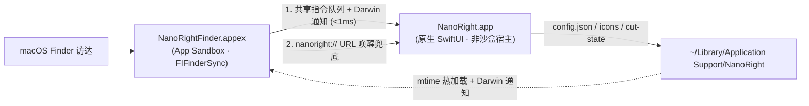

<div align="center">

# NanoRight · 简约右键

**轻量、开源、完全免费、免登录的 Apple Silicon (`arm64`) 原生 macOS 访达右键增强工具**

*A lightweight, open-source, account-free, Apple Silicon native Finder context-menu enhancer for macOS.*

[](https://www.apple.com/macos/)
[-black?logo=apple)](https://support.apple.com/en-us/116943)
[](https://swift.org)
[](./LICENSE)
[](#)

</div>

---

## 为什么做 NanoRight（简约右键）？

macOS 访达（Finder）原生的右键菜单缺少太多高频效率功能：右键新建文件、一键拷贝路径、用终端/VS Code 打开当前目录、Windows 风格剪切粘贴、一键显示隐藏文件、快速计算文件哈希……

市面上许多 macOS 右键增强工具（如各类收费“超级右键”类工具）把最基础的右键新建、打开终端、路径拷贝等功能都锁在 **VIP 订阅** 或 **账号登录** 后面，还塞满广告与无关套件。

**NanoRight（简约右键）** 致力于做一个**干净、克制、高频全免费**的开源替代方案：

| 对比维度 | macOS 原生访达 | 常见收费右键工具 | **NanoRight（简约右键）** |
| :--- | :---: | :---: | :---: |
| 右键新建常见文件（含合法 Office OOXML） | ❌ | 部分收费 / 需 VIP | ✅ **全部免费** |
| 进入终端 / iTerm / VS Code / Cursor 等 App | ❌ | 部分收费 / 限制数量 | ✅ **自动探测 + 无限添加** |
| 拷贝路径（POSIX / Shell 转义）、剪切、彻底删除 | 部分缺失 | 需 VIP | ✅ **全部免费** |
| 文件信息与流式哈希（MD5 / SHA-1 / SHA-256） | ❌ | 少数支持 | ✅ **内置独立悬浮面板** |
| 无感静默模式（隐藏 Dock + 隐藏状态栏） | — | 较少支持 | ✅ **支持，点 Launchpad 回设置** |
| 账号登录 / 付费会员 / 弹窗推广 | 无 | 常见 | ❌ **零登录、零广告、纯本地** |
| 架构与源码 | 原生 | 闭源 | ✅ **纯 `arm64` 原生 Swift，MIT 开源** |

---

## 核心功能一览

### 1. 右键新建文件（New File）
- **自定义创建新文件**：弹窗输入任意文件名与后缀（如 `notes.md`、`deploy.sh`），自动处理重名冲突（`未命名.txt` → `未命名 2.txt`）。
- **13+ 高频内置格式**：`TXT`、`Markdown (.md)`、`Word (.docx)`、`Excel (.xlsx)`、`PPT (.pptx)`、`JSON`、`RTF`、`XML`、`YAML`、`Shell (.sh)`、`Python (.py)`、`HTML`、`CSV`。
  - `.docx` / `.xlsx` / `.pptx` 由纯 Swift 内置生成器创建**标准合法的 OOXML 压缩包结构**，Word / WPS / Pages / Excel / Numbers / Keynote 打开不报错。
  - `.sh` / `.py` 自动附带 Shebang 与可执行权限（`+x`）。
- **自定义模板文件**：支持导入任意本地文件（如 `.pages`、`.key`、`.psd`、公司标准文档模板等）作为新建模板。
- **自由定制**：拖拽排序、双击改名、勾选「主菜单」直接平铺到右键一级菜单，支持新建后提示音、自动打开、自动重命名。

### 2. 进入 App（终端 & 编辑器直达）
- 首次启动自动探测本机已安装的常用工具：`终端 (Terminal)`、`iTerm`、`Warp`、`Ghostty`、`WezTerm`、`VS Code`、`Cursor`、`Zed`、`Sublime Text`、`Xcode`。
- 随时点击「添加应用」加入任意 `.app`，支持智能区分终端类应用（自动定位到当前目录）与编辑器/通用应用。

### 3. 发送文件到… & 常用目录
- **移动文件到 / 复制文件到**：右键一键将选中文件归档至常用文件夹，目标重名自动安全递增，绝不静默覆盖。
- **常用目录**：在任意访达空白处右键快速跳转收藏文件夹，并支持选中文件夹一键「添加到常用目录」。

### 4. 高频工具箱（Toolbox）
- **路径与名称**：`拷贝路径`（支持标准 POSIX 路径 / Shell 转义路径）、`拷贝文件(夹)名称`。
- **高效文件流**：`剪切`（搭配空白处自动出现的 `粘贴到此 (N 项)` 与 `取消剪切`）、`彻底删除`（默认开启二次确认防误删）、`压缩为 ZIP`、`用文件名新建文件夹`、`解散文件夹`、`发送替身到桌面`、`授予写入权限`。
- **系统与开发高频**：`显示 / 隐藏隐藏文件`、`文件信息与哈希`（独立悬浮窗展示大小、权限、时间，并流式计算 MD5 / SHA-1 / SHA-256 支持一键复制）、`隔空投送 (AirDrop)`、`设置为墙纸`（仅图片显示）、`打印`、`锁定屏幕`。
- **清爽菜单控制**：支持折叠「工具箱」与「进入 App」子菜单、开关菜单图标。

### 5. 无感静默模式（Stealth Mode）
- 独立提供 **「显示菜单栏（状态栏）图标」** 与 **「显示程序坞（Dock）图标」** 两个开关。
- 两者全部关闭后，应用在后台零打扰静默运行，不占 Dock 栏也不占顶部状态栏；需要修改设置时，在 **启动台（Launchpad）** 或访达中再次点击「简约右键」图标即可立即呼出设置窗口。

---

## 快速安装与使用

### 方式一：直接安装成品 `.app`（推荐）
1. 下载或获取已编译好的 `NanoRight.app`，直接双击打开。
2. 点击设置页顶部的 **「一键安装到应用程序」**（或手动拖入 `/Applications` 后打开），应用会自动完成插件注册。
3. 点击 **「前往开启扩展」** 勾选 **简约右键 (NanoRight)**，再点击 **「重启访达」** 即可在访达右键菜单中看到全部功能。

### 方式二：从源码编译（无需安装完整版 Xcode）
仅需 macOS Command Line Tools（`xcode-select --install`），支持 Apple Silicon (`arm64`) macOS 14.0+：

```bash
# 1. 克隆仓库
git clone https://github.com/PocoSen/NanoRight.git
cd NanoRight

# 2. 运行单元测试（Swift Testing）
make test

# 3. 编译并打包纯 arm64 原生应用（生成 build/NanoRight.app）
make build

# 4. 安装到 /Applications 并自动注册启用访达扩展
make install
```

---

## 技术架构

NanoRight 采用标准的 macOS 双进程架构，将受限的访达扩展与高权限宿主应用彻底解耦：



- **`Sources/NanoRightCore`**：跨进程共享的纯 Swift 核心库（零 AppKit 依赖，兼容 App Extension），包含配置持久化、OOXML ZIP 模板生成器、流式 CryptoKit 哈希计算与完整单元测试。
- **`Sources/NanoRightFinder`**：沙盒化的 `FinderSync` 扩展（`.appex`，`_NSExtensionMain` 入口），使用 `NSMenuItem.tag` 映射规避 Finder XPC 剥离 `representedObject` 的系统限制，并通过双通道 UUID 去重机制将指令可靠派发给宿主。
- **`Sources/NanoRightApp`**：纯原生 SwiftUI + AppKit 宿主应用，负责设置界面、图标缓存同步、自注册安装引导及所有本地文件与系统动作执行。

---

## 常见问题（FAQ）

<details>
<summary><b>1. 安装后访达右键没有出现菜单怎么办？</b></summary>

1. 打开 NanoRight 设置 → **通用设置** → 点击 **「前往开启扩展」**，确认已勾选 **简约右键 (NanoRight)**。
2. 点击 **「重启访达」**（或在终端执行 `killall Finder`）。
3. 注意：macOS 的 `FinderSync` 扩展在 iCloud Drive / OneDrive 等第三方云盘接管的目录中可能与云盘扩展互斥，建议先在本地目录（如 `~/Downloads` 或 `~/Documents`）测试。
</details>

<details>
<summary><b>2. 关闭了 Dock 和状态栏图标后，怎么再次进入设置或退出？</b></summary>

- **重新打开设置**：在 **启动台（Launchpad）**、**聚焦搜索（Spotlight）** 或 `/Applications` 中再次点击「简约右键 / NanoRight」图标，设置窗口会自动置顶弹出。
- **退出应用**：打开设置窗口后，点击左侧边栏底部的 **「退出简约右键」** 或按下 `Cmd + Q`；按 `Cmd + W` 或点关闭按钮仅关闭设置窗口，不影响后台右键功能。
</details>

<details>
<summary><b>3. 为什么只支持 Apple Silicon (`arm64`)？</b></summary>

NanoRight 专为 M 系列芯片 Mac 原生编译，体积更小、启动更快、无 Rosetta 转译开销。如果你有 Intel (`x86_64`) 需求，只需调整 `scripts/build_app.sh` 中的 `--arch` 与 `-target` 参数即可自行编译。
</details>

---

## 开源协议与署名

本项目基于 [MIT License](./LICENSE) 开源，欢迎 Star、Issue 与 Pull Request！

- **维护者**：[@PocoSen](https://github.com/PocoSen)
- **协同设计与开发**：Antigravity (Google DeepMind)
